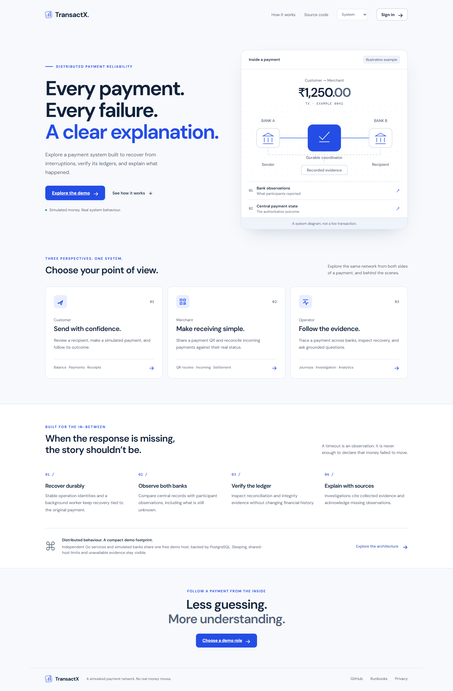
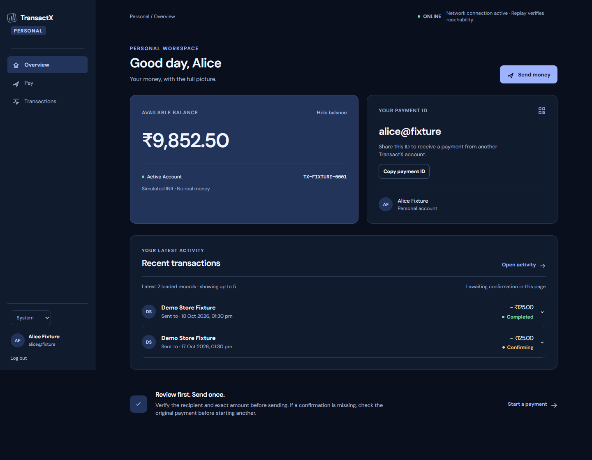
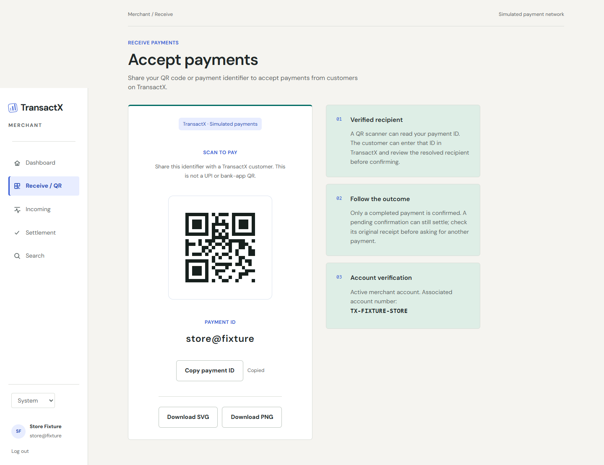
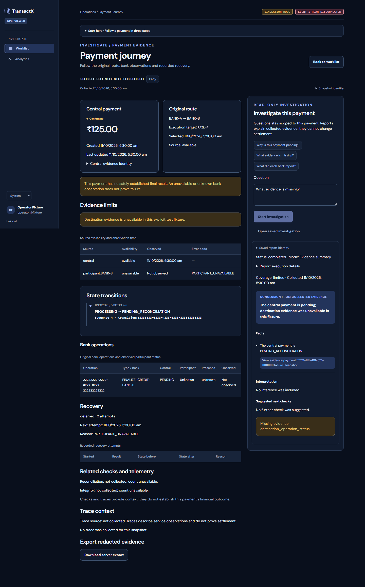
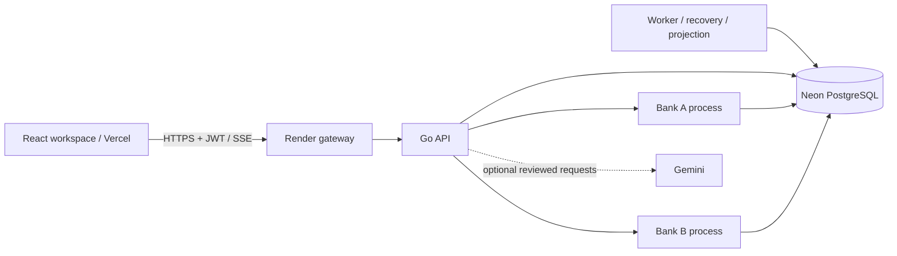

# TransactX

### Distributed payment reliability and evidence-led operations

Send a simulated payment, follow its journey across two bank participants,
and understand what the system can prove when a response goes missing.
TransactX combines a Go payment kernel with customer, merchant and operator
workspaces. **Synthetic money only:** no real banks, UPI/NPCI or real transfers.

[Live demo](https://transactx-frontend.vercel.app) ·
[Architecture](docs/architecture.md) ·
[Deployment](deploy/render/README.md) ·
[Engineering reference](docs/reference/payment-kernel.md)



**Experience V3 is live on the shared synthetic demo.** Backend and frontend
source `cafae17` was deployed on 19 October 2026. Customer receipts, merchant
activity, automatic operator projection and a saved evidence-summary report
with working citations were checked against the real HTTPS API. The screenshots
in this README use intercepted synthetic test responses; they are UI examples.
Google first and returning sign-in passed for the owner's External/Testing
account, with independently checked zero balances and stable identity. Public
Google access is not published. Gemini remains disabled: legacy 2.5 requests
returned `404 NOT_FOUND`; the instrumented 3.5 response completed within its cap
and decoded correctly, but confused an evidence ID with an entity ID. Grounding
correctly rejected it. The request correction is locally tested, awaiting live acceptance.
Evidence-summary mode remains available; generated-report acceptance is pending.
This deployment is not full release acceptance.

## Try a role

Open **Try the demo** and choose a workspace. Shared accounts contain synthetic
activity; they are not private wallets. Public demo access never grants admin.

| Role | Explore | Access boundary |
| --- | --- | --- |
| Customer | Send, review, receipts, activity, offline intents | Own account and payments |
| Recipient | Receive and inspect incoming activity | Separate shared customer account |
| Merchant | Receive QR, incoming payments, settlement views | Merchant-owned activity |
| Operator | Worklist, journey, investigation, analytics | Read evidence; no money movement |

The `/showcase` library is a separate, read-only collection of labelled
illustrative scenarios. Its 192 records across eight stories never become live
payments, calibration data or fallback API responses. Explanations there are
prewritten, not Gemini output.

## What the system demonstrates

**Retry-safe settlement.** Integer paise, user-scoped idempotency and stable bank
operation identities keep retries attached to the original payment attempt.
PostgreSQL owns central payment state and its double-entry ledger.

**Recovery through uncertainty.** Routed payments use a durable saga across
independent participants. A timeout is an unknown outcome. Workers inspect the
same operation identity, retain pending reconciliation when evidence is missing,
and complete central recovery after verified participant settlement.

**Readable bank evidence.** The operator journey separates central state,
participant observations, recovery attempts and missing evidence. Saved reports
retain citations and their original scope rather than presenting an explanation
as a fresh financial observation.

**Reconciliation and proofs.** Bounded integrity checks compare authoritative
records. Maintained Merkle commitments retain participant, time scope, generation
and version. Verification rejects the wrong scope or a stale maintained root.

**A resilient client.** Payment review preserves exact decimal-to-paise input.
Account-isolated offline intents retain stable retry identities; an offline
intent is not a settled payment. Static shell caching excludes API/auth responses.
Light, dark and system themes apply across the workspaces.

**A read-only investigator.** Evidence summaries are the default. Optional Gemini
uses grounded structured reports and cited runbooks, with durable request/token
limits and no paid fallback. Provider absence or an expired approval leaves the
core API and worker available and returns an explicit evidence-summary fallback.

## Workspaces



Customer overview: stored account bank identity, exact balances, clear next
actions and separate incoming/outgoing history. Screenshot uses test fixtures.



Merchant receive: a readable payment identifier and QR with a white quiet zone.
The QR does not fabricate a completed payment. Screenshot uses test fixtures.



Operator journey: pending central state, scoped evidence and a saved-report
workflow. This screenshot is an intercepted fixture, not a live recovery claim.

## Architecture



The free demo runs separate API, participant and worker processes on one Render
host, with central and participant schemas in Neon. Shared hosting does not merge
their financial authority. Bank/database ports remain private. The gateway
enforces bounded demo admission; the worker consumes durable outbox events for
operational projections. The frontend uses the actual configured API origin.

Native Linux deployment scripts remain available separately. Neither deployment
path provisions paid resources. A sleeping free host can delay the first API
response; the frontend presents that state without periodic keepalive spending.

| Layer | Implementation |
| --- | --- |
| Payment and participants | Go, PostgreSQL 18, typed HTTP adapters, durable saga |
| Client | React, TypeScript, Vite, IndexedDB, static service worker |
| Identity | Application JWT; optional Google OIDC with PKCE and one-time exchange |
| Investigation | Canonical evidence, lexical runbook retrieval, optional Gemini |
| Analytics | Durable windows; statistical baseline by default |
| Experiment | IsolationForest remains experimental, not the default scorer |

## Engineering evidence

Evidence is tied to a source and environment. Fixtures and green CI do not prove
public deployment, native crashes, real Google consent or provider entitlement.

| Evidence | Scope and limitation |
| --- | --- |
| [Auth/provider PostgreSQL CI](.github/workflows/auth-provider-postgres.yml) | Disposable PostgreSQL 18, fresh migrations, legacy upgrade, OIDC/Gemini persistence and optional-provider startup composition; required tests must pass rather than skip |
| [Release validation](.github/workflows/release-validation.yml) | Backend/race/frontend gates and explicitly isolated lifecycle checks |
| [Browser fixtures](frontend/browser) | Rendered UI, roles, failure states, offline isolation and accessibility; intercepted responses are labelled test evidence |
| [Reconciliation experiments](docs/reconciliation-experiments.md) | Historical controlled measurements at their recorded source, not current production SLAs |
| [Resilience experiments](docs/resilience-experiments.md) | Recorded environments and limitations; not proof of every later source change |

Local V3 verification on 18 October 2026 covered signed OIDC claims/key rotation,
durable account provisioning, grounded Gemini transport fixtures, canonical
PostgreSQL upgrade conformance and optional-provider startup composition.
No external provider request was made for those tests. Cold composition is
distinct from native process kill/restart acceptance.

## Run locally

Use Go 1.27+, Node.js 22+ and an isolated PostgreSQL 18 database. Load private
configuration into the environment; the binaries do not automatically read
dotenv files. Apply **all** canonical migrations with the migration command.

```powershell
cd backend
go run ./cmd/migrate up
```

Follow the [local setup guide](docs/runbooks/local-development.md) for separate
API/bank/worker processes and the frontend. Never point an initializer or test
cleanup at an existing financial dataset. The demo seed command is for a newly
created, acknowledged empty demo database only.

For a host deployment, use the [free demo runbook](deploy/render/README.md) or
[native delivery guide](deploy/README.md). Preserve the working source and private
configuration as rollback; additive schema changes are not an invitation to erase
identity or financial history with a downgrade.

## Optional account configuration

- [Google sign-in](docs/runbooks/google-sign-in.md): separate Web OAuth client,
  exact callback and frontend origin, reviewed consent/audience. New Google
  customers start at zero and cannot select privileged roles or link by email.
- [Gemini zero-spend setup](docs/runbooks/gemini-zero-spend.md): actual key-project
  one-time configuration-bound billing/quota review, persistent caps and an
  immediate shared disable switch. No periodic renewal; the app cannot guarantee
  provider billing state or permanent free-tier availability.
- [Demo enrichment](docs/runbooks/demo-enrichment.md): read-only dry-run first,
  exact acknowledged Neon target, installed capacity guards and ordinary payment
  APIs. The existing `neondb` is supported without renaming or resetting it.

## Boundaries and attribution

This is a simulation and engineering demonstration, not a certified financial
service. Shared demos have bounded capacity. Illustrative stories, controlled
experiments and live observations are visibly distinct. Optional provider
features are not a prerequisite for payment or password sign-in availability.

TransactX is collaborative work. Original contributors and their authorship are
preserved in [Git history](https://github.com/whoevenisshubham/TransactX/commits/)
and [contributors](https://github.com/whoevenisshubham/TransactX/graphs/contributors).
The redesign extends that work without rewriting attribution. Third-party
dependencies retain their licenses; no copied commercial design assets are used.
