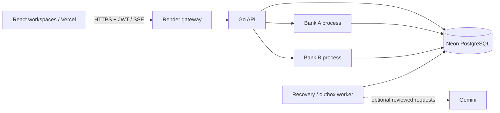

# TransactX

### Distributed payments, with a visible trail of evidence

TransactX is a payment reliability project with customer, merchant and operator
workspaces. Send a simulated payment, follow its journey across two independent
bank participants, and understand what the system can prove when a response goes
missing.

The project combines a Go payment kernel, PostgreSQL financial records and React
workflows with durable recovery, reconciliation, cryptographic evidence and
source-grounded investigations. Its central question is practical: **how do you
recover a payment safely when different services have different observations?**

**[Explore the live demo](https://transactx-frontend.vercel.app)** ·
[Architecture](docs/architecture.md) ·
[Local setup](docs/runbooks/local-development.md) ·
[Deployment](deploy/render/README.md) ·
[Payment kernel reference](docs/reference/payment-kernel.md)

## What makes the project interesting

- **One payment crosses independent services.** A central coordinator works with
  two bank participants. Each keeps its own records, so recovery must compare
  observations without inventing a result when one participant is unavailable.
- **Correctness survives retries.** Stable payment and operation identities,
  integer money and a double-entry ledger keep repeated requests attached to the
  original financial attempt.
- **Reliability is visible in the product.** Customers receive clear payment
  states; merchants can distinguish completed receipts from uncertain outcomes;
  operators can inspect the evidence behind both.
- **Explanations are accountable.** Investigations retain their evidence snapshot,
  missing observations and exact citations. Optional generated reports pass
  structured validation and grounding checks before they are accepted.

## Explore a complete workflow

Open **Explore the demo** and choose a workspace. No registration is required for
the shared demo roles. The separate [scenario library](https://transactx-frontend.vercel.app/showcase)
provides guided, read-only examples of settlement, uncertainty, recovery,
projection, integrity, offline use and investigation.

| Workspace | A useful path through the product | Access boundary |
| --- | --- | --- |
| Customer | Open Alice, inspect the bank/account identity, verify a recipient, review an exact amount and open the resulting receipt | Own account, payments and offline intents |
| Recipient | Open Bob to inspect the receiving side of a transfer and its incoming activity | Separate shared customer account |
| Merchant | Copy the store identifier, download its QR, inspect incoming payments and separate completed receipts from those awaiting confirmation | Merchant-owned activity |
| Operator | Filter the worklist, open a payment journey, compare bank observations, ask a scoped investigation question and follow report citations | Read-only public viewer; no money movement or admin access |

Private operator screens also cover bank health, routing/circuit controls,
reconciliation, integrity, Merkle proofs, audit activity and controlled faults.
They remain behind administrator authorization and are not exposed by the public
operator demo.

### Customer: review first, send once

The account overview brings together the available balance, stored bank identity,
payment identifier and Send action. Balance masking and filters work within the
loaded account history. The send flow verifies the recipient, parses decimal
rupees into integer paise and asks the user to review the transfer before submission.
Receipts retain the amount, counterparties, route and original reference.

### Merchant: a receiving desk with context

The merchant workspace combines a shareable payment identifier and QR with incoming
activity and settlement views. Completed receipts and payments awaiting confirmation
remain distinct. Copy/download actions use the actual account identifier, and
expanded records retain references, routes and recorded settlement times.

### Operator: follow the facts through uncertainty

The journey places the authoritative payment outcome beside the original bank
path, then shows independent observations and their collection times. Missing
evidence and uncertain financial outcomes remain visible. Technical details are
available through progressive disclosure; citations reveal their target section,
scroll to the exact record and focus it. Saved investigations keep their original
scope rather than presenting an old explanation as a fresh observation.

Screenshots use intercepted synthetic fixtures of the application UI. They are
product illustrations; live account activity may differ.

## How reliability works

### Retry-safe settlement

Money is stored as **integer paise**, avoiding floating-point rounding in payment
amounts. A **double-entry ledger** records matching debit/credit entries so that
financial movement can be checked independently of a status label.

**Idempotency** means a retry with the same user-scoped request identity refers to
the same payment attempt. Stable bank operation identities extend that protection
to participant calls. PostgreSQL owns central payment state and its ledger;
participants retain authority over their own operations.

### Recovery through uncertain outcomes

A **durable saga** is a recorded sequence of steps across services, with enough
state for a worker to continue later. If a response is lost, the worker checks
the original bank operation. A timeout remains an unknown outcome until evidence
establishes what happened; recovery can retain pending reconciliation instead of
mistaking silence for failure.

A **transactional outbox** records operational events alongside authoritative
changes. The worker consumes those durable events to build operator projections
— convenient read views of the payment history — without making a browser refresh
responsible for financial correctness.

### Independent bank evidence, reconciliation and proofs

Central state, participant observations and recovery attempts are separate sources.
The operator view exposes their availability and source times so disagreements can
be investigated explicitly.

**Reconciliation** compares records across those sources to find discrepancies.
**Integrity checks** evaluate persisted financial invariants, including ledger
consistency. Bounded checks keep their scope visible rather than implying every
record in the system was examined.

**Merkle commitments** summarize a scoped set of records with a cryptographic root;
a proof can check a record against that commitment. Maintained roots retain
participant, time scope, generation and version. Verification rejects the wrong
scope or a stale maintained root, so a valid-looking hash is not treated as a
universal proof of payment correctness.

### Offline intents and account-isolated replay

An offline payment is first a saved **intent**, not settled money. The client stores
its stable retry identity locally and waits for connectivity and a verified account
session. Queues are isolated by account so switching users cannot replay another
account's saved intent. Exact input/review behavior and the original payment identity
remain intact across retry.

The service worker caches the static application shell and assets, including fonts.
API and authentication responses are excluded. Visual updates wait for existing
tabs to close rather than taking over a payment in progress.

### Grounded investigations and evidence fallback

The investigator collects a scoped evidence snapshot and relevant runbook passages.
Optional Gemini produces a structured report containing supported facts,
interpretation, missing evidence and read-only next checks. Report shape, claims
and citations are validated against the collected sources; a fluent response does
not establish a financial outcome.

Saved reports preserve evidence IDs and snapshot provenance. Citations return to
exact source records. When the provider is unavailable, quota is exhausted, or
configuration is unusable, the system visibly uses an **evidence summary** instead.
Login, payments and recovery remain independent of provider availability.

Provider requests use server-only credentials, explicit project/model configuration,
durable daily request/token caps, bounded concurrency/timeouts and an immediate
disable switch. There is no paid fallback or periodic manual approval renewal.

## Architecture and technology

The hosted demo runs separate API, participant and worker processes on one Render
host, with central and participant schemas in Neon. Shared hosting does not merge
their financial authority. Bank/database ports stay private; the gateway exposes
bounded HTTPS admission to the application. The frontend uses the configured API
origin and application JWTs. SSE carries refresh hints for operational views,
not bank-health verdicts.

| Layer | Implementation and purpose |
| --- | --- |
| Payment coordinator and participants | Go HTTP services and typed bank adapters; durable cross-service payment steps |
| Financial persistence | PostgreSQL 18; central double-entry ledger and independent participant records |
| Recovery and operational views | Durable worker state and transactional outbox projections |
| Client | React, TypeScript, Vite, IndexedDB and static-only service worker; self-hosted DM Sans |
| Identity | Application JWT; Google OIDC with PKCE and a one-time application exchange |
| Investigation | Canonical evidence, lexical runbook retrieval, structured validation and optional Gemini |
| Analytics | Durable measured windows and a statistical baseline; IsolationForest remains experimental |
| Operations | Reconciliation, integrity/Merkle checks, audit records and telemetry context |

## Engineering evidence

Checks are tied to their source and environment. The following provide useful
entry points for a deeper review:

| Evidence | What it covers |
| --- | --- |
| [Release validation CI](.github/workflows/release-validation.yml) | Backend/race/frontend gates and explicitly isolated lifecycle checks |
| [Auth/provider PostgreSQL CI](.github/workflows/auth-provider-postgres.yml) | Disposable PostgreSQL, fresh/legacy migrations, OIDC/Gemini persistence and optional-provider composition; required tests must pass rather than skip |
| [Browser checks](frontend/browser) | Role boundaries, payment review, QR actions, reports/citations, failure states, accessibility, responsive layouts and offline shell behavior |
| [Reconciliation experiments](docs/reconciliation-experiments.md) | Recorded controlled measurements with their original scope |
| [Resilience experiments](docs/resilience-experiments.md) | Recorded environments, recovery scenarios and explicit limitations |

The [delivery report](docs/next-gen/DELIVERY_REPORT.md) records source-specific hosted
and operational acceptance, including real consent/provider/offline evidence and
outstanding exclusions. Fixture screenshots and green CI are not substitutes for
live integration or native process-crash evidence.

## Setup and maintained guides

Use the linked guides for commands, private configuration, all canonical migrations
and separate API/bank/worker startup. The binaries do not automatically load dotenv
files. Never point initialization or destructive test cleanup at an existing
financial dataset.

- [Local development](docs/runbooks/local-development.md)
- [Existing free Render/Vercel/Neon deployment](deploy/render/README.md)
- [Google sign-in setup](docs/runbooks/google-sign-in.md)
- [Gemini configuration and durable limits](docs/runbooks/gemini-zero-spend.md)
- [Guarded synthetic demo enrichment](docs/runbooks/demo-enrichment.md)
- [Payment kernel engineering reference](docs/reference/payment-kernel.md)

## Demo limitations

This is an engineering simulation: no real money, real banks or UPI/NPCI transfers.
Shared demo activity is visible to other visitors and has bounded capacity. Private
Google access currently uses an External/Testing audience; new private accounts
start at zero. The free API sleeps between visits, so the first authenticated
request can be slow; there is no periodic keepalive to mask that behavior.

Illustrative scenarios are prewritten examples and never become live observations
or model-calibration data. Provider review is bound to the actual key/project/model,
without time-based renewal; the app cannot independently guarantee billing state
or permanent free-tier availability. Standalone native Linux installation
certification and unverified scheduled-backup/RPO work are separate operational
deliverables, not claims of the hosted demo.

## Contributors and attribution

TransactX is collaborative work. Original authorship is preserved in
[Git history](https://github.com/whoevenisshubham/TransactX/commits/) and
[contributors](https://github.com/whoevenisshubham/TransactX/graphs/contributors).
Third-party licenses, self-hosted font licensing and benchmark provenance are
retained. Product artwork is original; commercial reference-site assets are not
copied into the project.
