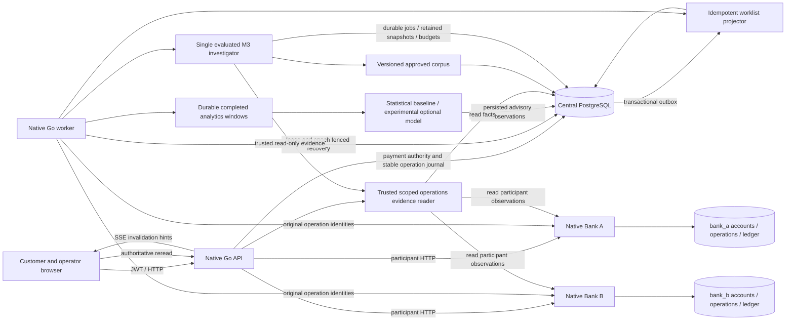

# Delivery architecture

## v2 operations and delivery boundary

Combined delivery acceptance is recorded in [the delivery report](DELIVERY_REPORT.md).
The diagram describes the current mounted components, not a completed release.

Central settlement remains authoritative; each participant owns its effects.
An unknown bank outcome remains unresolved until correlated status/presence
evidence supports safe continuation. Outbox delivery is at least once;
projection is idempotent and may lag. SSE is a hint, never financial truth.
Investigator and anomaly results have no mutation edge into the payment kernel.
Providers stay disabled, baseline remains default and IsolationForest experimental.

JWT roles gate operator reads and administrator controls. Native Linux deployment
uses systemd and Caddy with private bank/database ports. There is no OAuth/IdP,
Kubernetes or paid-provider prerequisite. Recorded native proofs cover named
process/fault boundaries; broader crash-harness and calibration provenance
requirements remain open in the delivery report.
