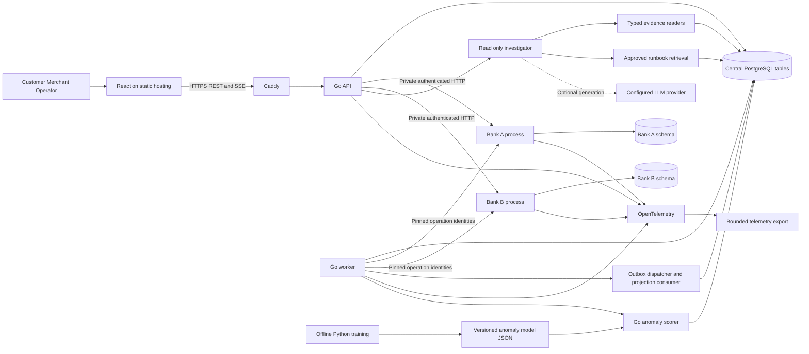
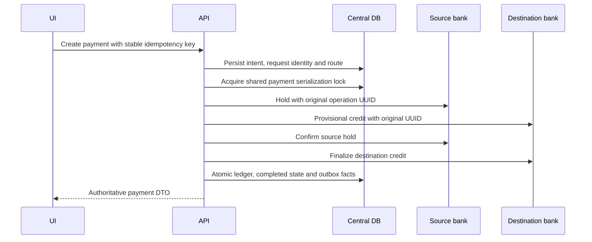
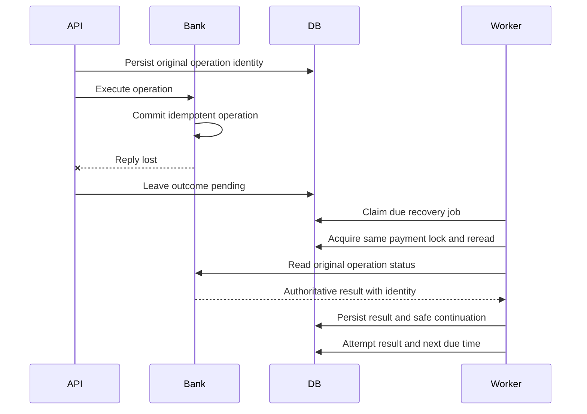
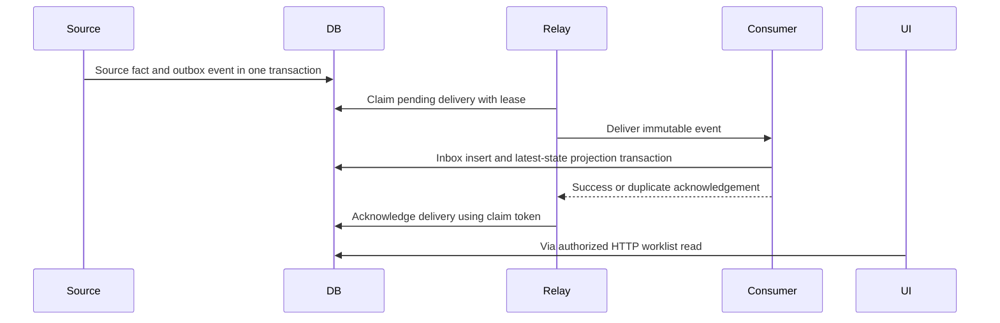
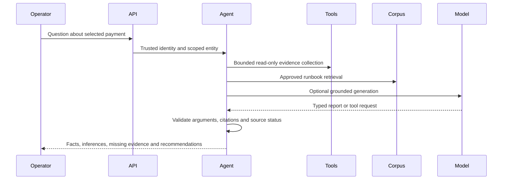

# Target architecture and ownership

## Components



Boxes are logical components, not a request to create a separate service for every box. The immediate runtime is four Go processes: API, Bank A, Bank B, worker. Investigator and anomaly scoring are packages. PostgreSQL is one server with separate authoritative and derived tables. Python is offline tooling.

## Ownership and dependency rules

| Data | Authority | Allowed writes |
| --- | --- | --- |
| Central payments, accounts, ledger, idempotency | Existing payment kernel | Existing deterministic workflows, extended only by reviewed recovery continuation |
| Participant operations, accounts, holds, ledger | Respective bank service | Its typed participant operations and explicit existing simulation setup |
| Recovery jobs and attempts | Recovery scheduler | Worker claims/results, deterministic recheck control, discovery |
| Outbox immutable event records | Source transaction | Trigger or repository write in the same transaction |
| Delivery state and consumer inbox | Dispatcher and named consumer | Claims, acknowledgements, retries, quarantine, deduplication |
| Operator worklist | Derived projector | Latest-state refresh or an atomic rebuild; never money writes |
| Trace/log/metric data | Telemetry | Bounded exporter; advisory, lossy and non-authoritative |
| Corpus and investigations | Investigator | Approved ingestion, authorized read-tool records, validated reports |
| Analytics windows and anomaly scores | Analytics package | Aggregate jobs and versioned scoring; advisory only |

Existing shared-database simulation provisioning and reconciliation adapters have explicit cross-schema implementation details. Audit these before tightening PostgreSQL grants. Keep participant monetary writes inside their owning implementation. Do not claim physical database isolation merely because schemas differ.

No circular package dependency: `payments` knows neither investigator nor frontend. `investigator` depends on its own read interfaces, implemented by adapters. `anomaly` consumes normalized operational feature vectors. `http` and the runtime composition package wire these together. `outbox` exposes infrastructure types; it cannot decide financial policy.

## Payment execution



The diagram compresses the intermediate durable state transactions. There is no transaction spanning both banks and central PostgreSQL. Existing compensation semantics remain stage dependent. Source confirmation is a critical boundary: unresolved destination finalization after source debit cannot be undone by guessing.

## Partial failure and recovery



If the API dies before sending the request, status can remain PENDING. The separate presence capability must distinguish confirmed absence from unresolved status for participants that support it. Retry only the original immutable operation against the same participant, whose uniqueness and payload checks serialize delayed and repeated requests. If absence cannot be established safely, park the payment for investigation; never replace its UUID or participant.

## Reliable operational updates



Consumer and relay may run within the worker but retain the duplicate/restart boundary in tests. They communicate through a typed event handler, not a fictional network broker. A crash between consumer commit and acknowledgement redelivers the same event. Projector reads central current state and stores its version; late events cannot restore an old financial status.

## Reconciliation and proof flow

```mermaid
sequenceDiagram
    participant Operator
    participant API
    participant Canonical
    participant Participant
    Operator->>API: Select closed scope and participant
    API->>Canonical: Read maintained commitment generation
    API->>Participant: Read compatible maintained generation
    API->>API: Compare roots and descend divergent buckets
    API-->>Operator: Durable run, discrepancies, metrics
    Operator->>API: Request and independently verify proof
    API-->>Operator: Bound scope, generation, record and root result
```

Missing commitments are visible errors; a read endpoint cannot quietly bootstrap them. Recovery does not use a Merkle mismatch as permission to edit money. Scheduled reconciliation is permitted only over maintained compatible closed scopes.

## Operator investigation

The worklist is an eventually consistent index. Selecting a row fetches the authoritative payment evidence API. The screen shows fetch time, source availability, original route, current operations and attempts, then related reconciliation evidence and telemetry. If a bank is unavailable, the screen reports that missing source rather than a false failure. A redacted export records its source times and SHA-256 manifest.

## Agent investigation



There is no financial mutation arrow. The model cannot supply its own user, role or authorization scope. Reports are snapshots with a freshness limit, not current payment truth.

## Scaling and failure domains

At ten times demo load, measure database indexes, per-payment lock contention, pool wait, worker throughput and projection lag. Adjust bounded concurrency only after preserving query reserve and bank capacity. At one hundred times load, separate participant databases, scale stateless API replicas after externalizing local breaker/chaos state, introduce a broker only when downstream delivery/throughput needs justify it, and isolate analytical workload.

Do not scale API replicas immediately: the current circuit and chaos runtime has process-local state and observers. The first release runs one API and tests two worker processes for claim correctness. Multi-API routing consistency is an explicit future decision.
